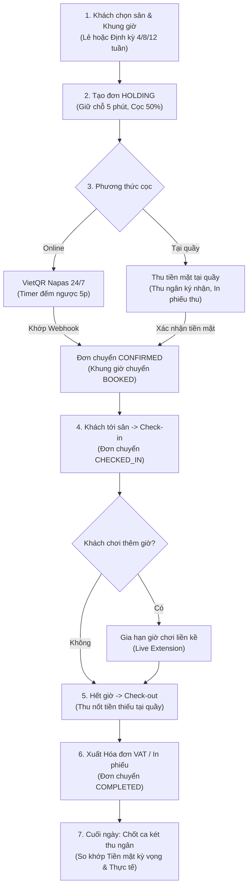
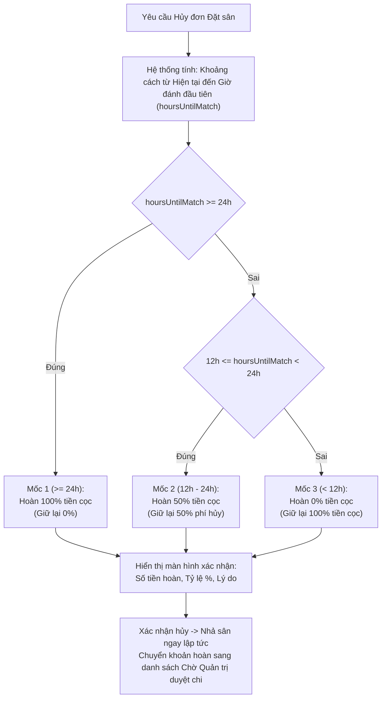

# TÀI LIỆU NGHIỆP VỤ, QUY TRÌNH, CHÍNH SÁCH VÀ YÊU CẦU HỆ THỐNG COURTLY
**Phiên bản:** 2.0.0 (Cập nhật toàn diện)  
**Hệ thống:** Nền tảng Quản trị & Đặt sân Tennis Trực tuyến Courtly (Courtly Tennis Management Platform)  
**Ngày cập nhật:** 27/10/2026  

---

## MỤC LỤC
1. [TỔNG QUAN HỆ THỐNG & ĐỐI TƯỢNG SỬ DỤNG](#1-tổng-quan-hệ-thống--đối-tượng-sử-dụng)
2. [KIẾN TRÚC KỸ THUẬT & DỮ LIỆU](#2-kiến-trúc-kỹ-thuật--dữ-liệu)
3. [MA TRẬN VAI TRÒ & PHÂN QUYỀN (RBAC)](#3-ma-trận-vai-trò--phân-quyền-rbac)
4. [MÔ HÌNH SÂN BÃI, KHUNG GIỜ & BẢNG GIÁ](#4-mô-hình-sân-bãi-khung-giờ--bảng-giá)
5. [4 TRỤ CỘT DOANH THU & NGUYÊN TẮC TÀI CHÍNH](#5-4-trụ-cột-doanh-thu--nguyên-tắc-tài-chính)
6. [QUY TRÌNH NGHIỆP VỤ CHI TIẾT (BUSINESS WORKFLOWS)](#6-quy-trình-nghiệp-vụ-chi-tiết-business-workflows)
   - 6.1. Quy trình Đặt sân Online (Khách lẻ & Đặt định kỳ 4, 8, 12 tuần)
   - 6.2. Quy trình Thanh toán cọc qua VietQR Napas 24/7 & Khớp lệnh tự động
   - 6.3. Quy trình Thu tiền mặt tại quầy & In phiếu thu
   - 6.4. Quy trình Chốt ca thu ngân cuối ngày & Bàn giao két
   - 6.5. Quy trình Check-in, Check-out & Gia hạn giờ chơi
   - 6.6. Quy trình Đổi lịch sân & Tính chênh lệch giá
   - 6.7. Quy trình Hủy đơn & Chính sách hoàn cọc 3 mốc thời gian
   - 6.8. Quy trình Đối soát giao dịch ngân hàng & Xử lý ngoại lệ tài chính
   - 6.9. Quy trình Bảo trì sân theo khung giờ linh hoạt
   - 6.10. Quy trình Xuất hóa đơn dịch vụ & Phiếu thu in nhiệt
   - 6.11. Quy trình Giải đấu Tennis & Bốc thăm thi đấu
   - 6.12. Quy trình Hội viên Membership (Gói Club & Plus)
   - 6.13. Quy trình Xóa tài khoản Admin có kiểm tra ràng buộc toàn vẹn
7. [CHÍNH SÁCH VẬN HÀNH & KỶ LUẬT TÀI CHÍNH](#7-chính-sách-vận-hành--kỷ-luật-tài-chính)
8. [DANH MỤC YÊU CẦU CHỨC NĂNG (FUNCTIONAL REQUIREMENTS - FR)](#8-danh-mục-yêu-cầu-chức-năng-functional-requirements---fr)
9. [DANH MỤC YÊU CẦU KỸ THUẬT & PHI CHỨC NĂNG (TECHNICAL REQUIREMENTS - TR)](#9-danh-mục-yêu-cầu-kỹ-thuật--phi-chức-năng-technical-requirements---tr)

---

## 1. TỔNG QUAN HỆ THỐNG & ĐỐI TƯỢNG SỬ DỤNG

### 1.1. Sứ mệnh hệ thống
Courtly là giải pháp chuyển đổi số toàn diện cho câu lạc bộ tennis chuẩn quốc tế, giải quyết triệt để các bài toán:
- **Khách hàng**: Đặt sân trực quan theo sơ đồ, thanh toán VietQR tức thì, đặt định kỳ dài hạn, đổi lịch linh hoạt, tra cứu vé điện tử.
- **Lễ tân / Thu ngân**: Thu tiền mặt chuẩn chỉ, in phiếu thu ngay tại chỗ, chốt ca két cuối ngày không lệch số liệu, check-in/check-out nhanh chóng.
- **Quản lý / Ban giám đốc**: Giám sát công suất lấp đầy sân theo thời gian thực, quản lý bảo trì cục bộ, đối soát ngân hàng tự động, báo cáo doanh thu bóc tách 4 trụ cột độc lập.

### 1.2. Đối tượng phục vụ
1. **Khách vãng lai (Guest)**: Xem thông tin sân, bảng giá, sơ đồ sân, tin tức, điều lệ giải đấu; có thể đặt sân nhanh tại quầy hoặc đăng ký tài khoản để đặt online.
2. **Khách hàng hội viên (Customer / Member)**: Đặt sân trực tuyến, đặt định kỳ 4/8/12 tuần, hưởng quyền lợi hội viên (Club/Plus), áp dụng voucher, quản lý lịch sử đặt sân và hóa đơn.
3. **Nhân viên lễ tân / Thu ngân (Staff / Cashier)**: Vận hành lịch sân, check-in, check-out, gia hạn giờ chơi, thu tiền mặt tại quầy, xuất hóa đơn, thực hiện chốt ca giao két.
4. **Quản trị viên / Chủ sân (Admin / Owner)**: Cấu hình danh mục sân, phân loại sân (VIP, INDOOR, OUTDOOR), quản lý bảng giá, duyệt hoàn tiền, đối soát tài chính, quản lý giải đấu, phân quyền và xóa tài khoản an toàn.

---

## 2. KIẾN TRÚC KỸ THUẬT & DỮ LIỆU

### 2.1. Ngăn xếp công nghệ (Technology Stack)
- **Backend**: Java 17, Spring Boot 3.5.16 (Spring MVC, Spring Data JPA, Spring Security, Hibernate 6).
- **Database**: PostgreSQL 16 (Hỗ trợ ACID, Advisory Locks `pg_advisory_xact_lock`, Locking Pessimistic `PESSIMISTIC_WRITE`).
- **Frontend**: React 18, Vite 6, React Context State Management, Lucide Icons, QRCode SVG/Canvas.
- **Cổng thanh toán**: Chuẩn VietQR (Napas 24/7), tích hợp Webhook ngân hàng (SePay / MB Bank) tự động kiểm tra chữ ký HMAC SHA256 và so khớp nội dung giao dịch.
- **Đóng gói & Vận hành**: Docker & Docker Compose (`tennis-court-git-backend-1:8081`, `tennis-court-git-frontend-1:3000`, `tennis-court-git-postgres-1:5433`).

### 2.2. Nguyên tắc bất biến về dữ liệu (Data Integrity Invariants)
1. **Khóa chống đặt trùng (Zero Double-Booking)**: Mọi thao tác tranh chấp khung giờ sân (`CourtSchedule`) hoặc đơn hàng (`CustomerOrder`) đều bắt buộc thực thi trong giao dịch có khóa hàng bi quan (`SELECT ... FOR UPDATE`).
2. **Kỷ luật giao dịch tài chính**: Không cho phép sửa đổi số tiền trên hóa đơn/phiếu thu đã hoàn tất. Các thay đổi về tiền sau khi xuất phiếu đều thông qua bản ghi `Payment` hoặc `Refund` độc lập.
3. **Phân tách phương thức thu tiền**:
   - `CASH`: Chỉ thu ngân ghi nhận tại quầy sau khi đã kiểm đếm tiền mặt thực tế.
   - `BANK_TRANSFER`: Chỉ được xác nhận tự động thông qua Webhook chuyển khoản ngân hàng có chữ ký số hoặc đối soát chuyên biệt của quản trị viên.

---

## 3. MA TRẬN VAI TRÒ & PHÂN QUYỀN (RBAC)

| Chức năng / Quyền hạn | GUEST | CUSTOMER | STAFF (Thu ngân) | ADMIN (Quản trị) |
|---|:---:|:---:|:---:|:---:|
| Xem sân, sơ đồ, bảng giá niêm yết | ✓ | ✓ | ✓ | ✓ |
| Đặt sân online (Lẻ & Định kỳ) | ✗ | ✓ | ✓ | ✓ |
| Thanh toán đặt cọc qua VietQR Napas | ✗ | ✓ | ✓ | ✓ |
| Check-in khách vào sân & Check-out | ✗ | ✗ | ✓ | ✓ |
| Thu tiền mặt tại quầy & In phiếu thu | ✗ | ✗ | ✓ | ✓ |
| Chốt ca thu ngân cuối ngày & Bàn giao két | ✗ | ✗ | ✓ | ✓ |
| Bảo trì khung giờ linh hoạt (Slot Maintenance) | ✗ | ✗ | ✗ | ✓ |
| Đổi lịch sân (Khách tự đổi / Quầy hỗ trợ) | ✗ | ✓ (≥24h) | ✓ | ✓ |
| Hủy đơn đặt sân (Theo chính sách hoàn 3 mốc) | ✗ | ✓ | ✓ | ✓ |
| Duyệt chi hoàn tiền về tài khoản ngân hàng | ✗ | ✗ | ✗ | ✓ |
| Đối soát giao dịch ngân hàng & Xử lý ngoại lệ | ✗ | ✗ | ✓ | ✓ |
| Xem Dashboard doanh thu 4 trụ cột & Xuất CSV | ✗ | ✗ | ✗ | ✓ |
| Xóa tài khoản người dùng (Ràng buộc toàn vẹn) | ✗ | ✗ | ✗ | ✓ |

---

## 4. MÔ HÌNH SÂN BÃI, KHUNG GIỜ & BẢNG GIÁ

### 4.1. Phân loại sân (Module 7: Court Types)
Hệ thống Courtly quản lý sân theo 3 chuẩn phân loại thực tế:
1. **Sân VIP (`VIP`)**: Cụm sân có khu vực khán đài riêng, phòng thay đồ cao cấp, phòng chờ VIP Lounge, hệ thống chiếu sáng tiêu chuẩn giải đấu quốc tế.
2. **Sân Trong Nhà (`INDOOR`)**: Sân có mái che kiên cố, chống chói, sàn nảy tiêu chuẩn US Open, hoạt động liên tục bất chấp mưa nắng.
3. **Sân Ngoài Sân / Ngoài Trời (`OUTDOOR`)**: Sân ngoài trời thoáng đãng, phủ lớp sơn acrylic chống trơn trượt, thích hợp tập luyện và thi đấu các khung giờ sáng sớm hoặc chiều tối.

### 4.2. Khung giờ hoạt động & Phân đoạn thời gian
- **Giờ mở cửa**: Từ 06:00 đến 23:00 hàng ngày (17 tiếng vận hành mỗi sân).
- **Độ dài khung giờ**: Mỗi slot kéo dài 30 phút hoặc 60 phút.
- **Phân loại giờ**:
  - *Giờ thường (Regular Hours)*: Khung giờ sáng (06:00 – 16:00) các ngày trong tuần.
  - *Giờ vàng (Peak Hours / Prime Time)*: Khung giờ chiều tối (16:00 – 22:00) và toàn bộ các ngày Thứ Bảy, Chủ Nhật.

---

## 5. 4 TRỤ CỘT DOANH THU & NGUYÊN TẮC TÀI CHÍNH

Theo chuẩn quản trị tài chính CLB thể thao hiện đại (Module 48), toàn bộ doanh số vận hành được phân định rõ ràng thành 4 trụ cột độc lập:

$$\text{Doanh thu thuần (Net Revenue)} = \sum_{i=1}^4 \text{Trụ cột}_i - \text{Tổng tiền hoàn (Refunds)}$$

### 5.1. Bóc tách 4 Trụ Cột Doanh Thu
1. **Trụ cột 1: Doanh thu thuê sân (Court Bookings)**:
   - Toàn bộ giá trị giờ chơi từ các loại sân VIP, Trong nhà và Ngoài trời.
   - Ghi nhận từ các đơn đặt online, đặt định kỳ và đặt trực tiếp tại quầy.
2. **Trụ cột 2: F&B & Đồ bán kèm (Food & Beverage / Retail)**:
   - Nước khoáng thể thao, nước điện giải, nước tăng lực.
   - Đồ ăn nhẹ, thanh năng lượng, khăn lạnh, quả bóng tennis mua đứt.
3. **Trụ cột 3: Dụng cụ & Dịch vụ trọng tài (Equipments & Staff Services)**:
   - Thuê vợt tennis theo giờ, thuê máy bắn bóng tập luyện.
   - Dịch vụ trọng tài chấm điểm trận đấu theo giờ chơi.
4. **Trụ cột 4: Phí giải đấu & Hội viên (Tournaments & Memberships)**:
   - Lệ phí đăng ký thi đấu các giải phong trào và bán chuyên do CLB tổ chức.
   - Phí kích hoạt gói hội viên thường niên / định kỳ (Gói Club, Gói Plus).

---

## 6. QUY TRÌNH NGHIỆP VỤ CHI TIẾT (BUSINESS WORKFLOWS)

---

### 6.1. Quy trình Đặt sân Online (Module 15: Khách lẻ & Định kỳ 4, 8, 12 tuần)
1. **Chọn hình thức**: Khách hàng chọn giữa **Đặt 1 buổi lẻ** hoặc **Đặt cố định định kỳ** (4 tuần, 8 tuần, 12 tuần) phục vụ hội nhóm hoặc doanh nghiệp.
2. **Chọn sân và thời gian**: Khách xem sơ đồ trực quan, chọn phân khu (VIP, Trong nhà, Ngoài trời) và khoảng thời gian mong muốn (bước 30 phút hoặc 60 phút).
3. **Tính toán chi phí & Voucher**: Hệ thống tự động tính:
   - Đơn giá giờ thường / giờ vàng theo từng sân.
   - Ưu đãi giảm giá nếu khách có gói hội viên Club (10%) hoặc Plus (15%).
   - Giảm trừ tiền từ Voucher khuyến mãi nếu nhập mã hợp lệ.
4. **Khởi tạo trạng thái giữ chỗ (`HOLDING`)**:
   - Khi khách bấm tiếp tục, hệ thống khóa bi quan (`PESSIMISTIC_WRITE`) các khung giờ đã chọn.
   - Đơn hàng được tạo ở trạng thái `HOLDING` với thời hạn giữ chỗ là 5 phút (`holdExpiresAt = Instant.now() + 5 minutes`).
   - Tiền cọc yêu cầu chuẩn là **50% tiền sân** (Phí dịch vụ trọng tài và dụng cụ được thanh toán khi hoàn tất đơn).

---

### 6.2. Quy trình Thanh toán cọc qua VietQR Napas 24/7 & Khớp lệnh tự động (Module 30)
1. **Sinh mã VietQR chuẩn EMVCo**: Hệ thống render mã VietQR động bao gồm ngân hàng nhận, số tài khoản CLB, số tiền cọc chính xác và cú pháp nội dung duy nhất (`CT...`).
2. **Đồng hồ đếm ngược giữ chỗ (Synced Real-time Timer)**:
   - Giao diện thanh toán hiển thị đồng hồ đếm ngược chính xác đến từng giây đồng bộ với `holdExpiresAt`.
   - Nếu quá thời gian đếm ngược mà ngân hàng chưa xác nhận tiền vào, hệ thống cảnh báo đơn đã hết hạn và tự động nhả slot sân cho người khác.
3. **Khớp lệnh tự động qua Webhook**:
   - Khách chuyển khoản qua ứng dụng Mobile Banking bất kỳ.
   - Ngân hàng gửi webhook báo có về endpoint `/api/transfers/webhook`.
   - Backend xác thực chữ ký SHA256, tìm giao dịch tương ứng, cập nhật số tiền `paidAmount`, đổi trạng thái đơn sang `CONFIRMED` và chuyển toàn bộ slot sân sang `BOOKED`.
   - Màn hình khách hàng tự động chuyển sang trạng thái "GIAO DỊCH THÀNH CÔNG" ngay tức thì.

---

### 6.3. Quy trình Thu tiền mặt tại quầy & In phiếu thu (Module 31)
1. **Truy cập màn hình Thu ngân (`CashDesk`)**: Nhân viên lễ tân hoặc quản trị viên mở tab "Thu tiền tại quầy".
2. **Chọn đơn cần thu**: Danh sách hiển thị các đơn đang chờ thu cọc (`HOLDING`) hoặc đơn cần thanh toán nốt phần tiền còn thiếu trước/sau khi chơi.
3. **Kiểm đếm tiền mặt**: Thu ngân đếm đúng số tiền mặt nhận từ khách, nhập vào ô "Số tiền mặt thực nhận" (tối đa không quá số tiền còn thiếu của đơn).
4. **Xác nhận giao dịch**: Thu ngân tích vào cam kết "Tôi đã nhận tiền mặt và kiểm tra đúng đơn" và bấm "Xác nhận tiền mặt đã thu".
5. **Ghi nhận tài khoản thu ngân (`receivedByAccount`)**: Backend lưu mã ID tài khoản thu ngân trực tiếp thực hiện giao dịch vào trường `received_by_account_id` của bản ghi `Payment`.
6. **In phiếu thu tại chỗ**: Hệ thống hiển thị ngay Thẻ Phiếu Thu Tiền Mặt (CLB Tennis Courtly, Mã phiếu, Khách hàng, Số tiền, Thu ngân thực hiện, Thời gian) kèm nút "In phiếu thu" (`window.print()`).

---

### 6.4. Quy trình Chốt ca thu ngân cuối ngày & Bàn giao két (Module 35)
1. **Mở bảng chốt ca**: Tại màn hình Thu ngân, bấm nút "💼 Chốt ca thu ngân".
2. **Thống kê tự động trong ca**: Hệ thống tổng hợp toàn bộ giao dịch phát sinh từ đầu ngày đến thời điểm hiện tại:
   - Tổng tiền mặt thu ngân đã thu (`cashCollected`) và số lượng phiếu thu.
   - Tổng tiền chuyển khoản VietQR tự động qua ngân hàng (`bankCollected`).
3. **Nhập số liệu kiểm két**:
   - `Tiền mặt đầu ca trong két`: Mặc định tiền lẻ dự trữ đầu ca (ví dụ 1.000.000₫).
   - `Tiền mặt kỳ vọng`: $\text{Kỳ vọng} = \text{Tiền đầu ca} + \text{Tiền mặt đã thu trong ca}$.
   - `Tiền mặt thực đếm khi giao ca`: Thu ngân đếm toàn bộ tiền mặt trong két và nhập số thực tế.
4. **Phát hiện chênh lệch**:
   - $\text{Chênh lệch} = \text{Thực đếm} - \text{Kỳ vọng}$.
   - Nếu chênh lệch = 0: Hiển thị xanh lá (Khớp 100%).
   - Nếu chênh lệch > 0: Cảnh báo thừa két; Nếu < 0: Cảnh báo thiếu két.
5. **Lưu biên bản bàn giao**: Thu ngân nhập ghi chú bàn giao ca và bấm "Xác nhận chốt ca & Lưu biên bản". Dữ liệu được mã hóa lưu trữ lâu dài kèm tính năng in biên bản bàn giao có chữ ký hai bên.

---

### 6.5. Quy trình Check-in, Check-out & Gia hạn giờ chơi (Live Extension)
1. **Check-in vào sân**: Khi khách đến CLB đúng giờ, lễ tân bấm "Thực hiện Check-in vào sân". Đơn chuyển trạng thái sang `CHECKED_IN`, lưu thời điểm `checkInAt`.
2. **Gia hạn giờ chơi (Live Extension)**:
   - Trong lúc khách đang chơi, nếu muốn đánh thêm 30p hoặc 60p, thu ngân bấm "⚡ Gia hạn giờ chơi".
   - Hệ thống tự động kiểm tra xem khung giờ liền kề tiếp theo của sân đó có bị ai đặt hay bảo trì không.
   - Nếu trống, hiển thị mức giá gia hạn (có áp dụng giảm giá hội viên nếu có). Thu ngân bấm duyệt, hệ thống cộng thêm slot vào đơn và tăng công nợ để thu nốt khi trả sân.
3. **Check-out trả sân**: Khi hết giờ chơi, lễ tân bấm "Check-out & Hoàn tất". Hệ thống chuyển trạng thái đơn sang `COMPLETED`, ghi nhận `checkOutAt`.

---

### 6.6. Quy trình Đổi lịch sân & Tính chênh lệch giá (Module 20: Reschedule)
1. **Khách hàng hoặc Thu ngân yêu cầu đổi lịch**: Đơn đang ở trạng thái `HOLDING` hoặc `CONFIRMED` có thể bấm "🔄 Đổi lịch sân".
2. **Chọn ngày và sân thay thế**: Chọn ngày chơi mới, loại sân mới (VIP, Trong nhà, Ngoài trời), giờ bắt đầu và thời lượng chơi.
3. **Kiểm tra tính khả dụng & Xem trước chênh lệch giá (Preview)**:
   - Backend khóa tạm thời để kiểm tra sân mới có trống không.
   - Tự động tính: $\text{Chênh lệch} = \text{Tổng tiền mới} - \text{Tổng tiền cũ}$.
   - Nếu lịch mới đắt hơn: Tính số tiền còn phải nộp thêm (`additionalDue`).
   - Nếu lịch mới rẻ hơn: Ghi nhận số tiền thừa vào diện đối soát hoàn lại cho khách (`reviewAmount`).
4. **Xác nhận đổi lịch**: Bấm "Xác nhận đổi lịch". Hệ thống giải phóng toàn bộ khung giờ cũ và khóa khung giờ mới. Toàn bộ lịch sử đổi lịch được lưu vết minh bạch trong `OrderTimeline`.

---

### 6.7. Quy trình Hủy đơn & Chính sách hoàn cọc 3 mốc thời gian (Module 34)

- **Mốc 1 ($\ge 24$ giờ trước giờ thi đấu)**: Khách được hoàn lại **100% số tiền cọc đã đóng** (CLB giữ lại 0%).
- **Mốc 2 (Từ 12 giờ đến dưới 24 giờ trước giờ thi đấu)**: Khách được hoàn lại **50% số tiền cọc** (CLB giữ lại 50% chi phí bồi hoàn cơ hội).
- **Mốc 3 (Dưới 12 giờ trước giờ thi đấu)**: Khách được hoàn lại **0% tiền cọc** (CLB giữ lại 100% tiền cọc do quá sát giờ không thể tìm khách thay thế).
- **Xử lý hoàn tiền**: Sau khi bấm xác nhận hủy, khung giờ sân được giải phóng ngay lập tức để người khác có thể đặt. Bản ghi hoàn tiền được đẩy vào mục **Đối soát & Ngoại lệ** để quản trị viên đối chiếu và bấm chuyển khoản trả khách.

---

### 6.8. Quy trình Đối soát giao dịch ngân hàng & Xử lý ngoại lệ tài chính (Module 32)
Màn hình "Thu tiền & hoàn tiền" tích hợp tab **Đối soát & Ngoại lệ** tự động quét toàn bộ cơ sở dữ liệu để lọc ra 3 nhóm tình huống ngoại lệ:
1. **Khách chuyển khoản thừa tiền (Overpayments)**: Trường hợp khách chuyển nhiều hơn tổng số tiền của đơn hàng (`paid > total`). Giao diện hiển thị số tiền chênh lệch thừa kèm nút "Xem đơn & Hoàn tiền thừa".
2. **Đơn chờ hoàn tiền theo chính sách (Pending Refunds)**: Toàn bộ các đơn khách đã hủy theo chính sách ở Mục 6.7 được tập hợp tại đây kèm lý do hủy, số tiền cần hoàn và trạng thái. Admin bấm "Xem & Hoàn tiền" để xác nhận lệnh hoàn.
3. **Đơn đã hủy/hết hạn nhưng phát sinh tiền (Late Payments)**: Trường hợp tiền chuyển khoản của khách vào ngân hàng chậm hơn thời gian giữ chỗ 5 phút, đơn đã tự hủy hoặc chuyển hết hạn. Hệ thống gom các khoản này để lễ tân hoặc admin liên hệ khách đổi sang khung giờ khác hoặc hoàn trả tiền.

---

### 6.9. Quy trình Bảo trì sân theo khung giờ linh hoạt (Module 13: Slot Maintenance)
Khắc phục nhược điểm đóng toàn bộ sân cả ngày, hệ thống hỗ trợ bảo trì cục bộ theo từng khung giờ:
1. Tại màn hình "Lịch sân", chọn một hoặc nhiều khung giờ cần xử lý (ví dụ: Sân A01 lúc 11:30 – 13:30 để bảo dưỡng lưới và sơn lại vạch).
2. Bấm nút **"🔧 Bảo trì khung giờ"**.
3. Hệ thống chuyển trạng thái các slot này từ `AVAILABLE` sang `MAINTENANCE`. Khung giờ chuyển màu xám tro, ghi rõ "Bảo trì / Tạm ngưng phục vụ". Khách hàng online không thể đặt vào khung giờ này, nhưng các khung giờ sáng sớm hoặc chiều tối của sân đó vẫn nhận khách bình thường.
4. Khi hoàn thành công tác bảo trì, lễ tân chọn lại các khung giờ đó và bấm **"Mở lại khung giờ"** để sân hoạt động bình thường trở lại.

---

### 6.10. Quy trình Xuất hóa đơn dịch vụ & Phiếu thu in nhiệt (Module 23)
1. Bấm nút "In hóa đơn" tại chi tiết đơn đặt sân.
2. Hệ thống tổng hợp đầy đủ các hạng mục:
   - Thông tin CLB: Tên CLB, Mã số thuế, Hotline, Địa chỉ.
   - Mã hóa đơn duy nhất dạng `HD-XXXXXXXX`.
   - Thông tin khách hàng, số điện thoại, ngày thi đấu.
   - Bảng kê chi tiết từng dòng: Khung giờ sân, Dụng cụ thuê, Đồ uống F&B, Dịch vụ trọng tài kèm đơn giá và thành tiền.
   - Dòng giảm giá chiết khấu hội viên và voucher khuyến mãi.
   - Tổng thanh toán, Đã thanh toán và Số tiền còn lại.
3. Hỗ trợ nút "🖨️ In Hóa Đơn / Xuất PDF" chuẩn tương thích khổ giấy in nhiệt K80 và in giấy A4/A5 tiêu chuẩn.

---

### 6.11. Quy trình Giải đấu Tennis & Bốc thăm thi đấu
1. **Tạo giải đấu**: Quản trị viên khởi tạo giải đấu mới (Tên giải, Thể thức: Đơn/Đôi/Đồng đội, Ngày bắt đầu, Hạn đăng ký, Lệ phí giải, Số lượng VĐV tối đa).
2. **Vận động viên đăng ký & Nộp lệ phí**:
   - VĐV đăng ký tham gia trực tuyến qua website.
   - Nộp lệ phí giải qua VietQR. Khi lệ phí thanh toán đủ, đăng ký chuyển trạng thái `CONFIRMED`.
3. **Bốc thăm ghép cặp & Xếp lịch**:
   - Khi hết hạn đăng ký, hệ thống tự động bốc thăm chia nhánh đấu (Bracket).
   - Gán trận đấu vào các khung giờ sân cụ thể trên lịch tổng. Các slot này tự động chuyển trạng thái sang `IN_MATCH` (Màu tím - Thi đấu).
4. **Cập nhật tỷ số**: Trọng tài hoặc quản trị viên nhập tỷ số từng set đấu để phân định người thắng vào vòng trong cho đến trận Chung kết.

---

### 6.12. Quy trình Hội viên Membership (Gói Club & Plus)
1. **Tham khảo & Đăng ký gói**:
   - Khách hàng xem danh mục gói hội viên tại trang Hội viên (Gói Club: Giảm 10% sân thường, 5% sân VIP; Gói Plus: Giảm 15% sân thường, 10% sân VIP, phòng VIP Lounge).
   - Bấm đăng ký gói và quét mã VietQR nộp phí hội viên.
2. **Kích hoạt gói**: Webhook ngân hàng xác nhận đủ phí, gói hội viên tự động chuyển trạng thái `ACTIVE` và tính ngày hết hạn.
3. **Áp dụng quyền lợi tự động**: Trong suốt thời hạn hội viên, khi đặt sân, hệ thống tự động áp mức chiết khấu hội viên vào báo giá đơn hàng.

---

### 6.13. Quy trình Xóa tài khoản Admin có kiểm tra ràng buộc toàn vẹn
Nhằm ngăn chặn hành vi phá hủy dữ liệu và đảm bảo toàn vẹn kế toán:
1. **Chỉ Quản trị viên tối cao (Owner/Admin)** mới có quyền truy cập chức năng xóa tài khoản tại danh mục Người dùng.
2. **Quy tắc chặn xóa an toàn (Safety Invariants)**:
   - Không được phép tự xóa tài khoản của chính mình.
   - Không được phép xóa tài khoản Chủ hệ thống (Owner Account).
   - Không được xóa tài khoản đã có lịch sử phát sinh dữ liệu nghiệp vụ: Đã từng tạo đơn đặt sân, đã từng có giao dịch thanh toán hoặc đã từng đăng ký tham gia giải đấu.
3. **Biện pháp xử lý tài khoản vi phạm**: Với các tài khoản có lịch sử giao dịch nhưng cần thu hồi quyền, chuyển trạng thái sang `LOCKED` (Khóa tài khoản) thay vì xóa vật lý khỏi cơ sở dữ liệu.

---

## 7. CHÍNH SÁCH VẬN HÀNH & KỶ LUẬT TÀI CHÍNH

1. **Chính sách đặt cọc**: Mọi đơn đặt sân qua cổng trực tuyến bắt buộc phải đặt cọc tối thiểu **50% giá trị tiền sân**. Nếu không thanh toán trong vòng 5 phút, sân tự động giải phóng.
2. **Chính sách phân quyền thanh toán**:
   - Nhân viên lễ tân chỉ được thu tiền mặt (`CASH`).
   - Tiền chuyển khoản (`BANK_TRANSFER`) do ngân hàng đối soát tự động qua webhook Napas 24/7. Tuyệt đối không chấp nhận ảnh chụp màn hình chuyển khoản giả mạo mà không có biến động số dư thực tế.
3. **Chính sách hoàn tiền**:
   - Trước 24h: Hoàn 100%.
   - Từ 12h đến 24h: Hoàn 50%.
   - Dưới 12h: Hoàn 0%.
   - Tiền hoàn không tự động bắn ngược về ngân hàng ngay lập tức mà được ghi nhận đối soát để Ban quản lý thực hiện chi trả theo đúng quy trình kiểm soát dòng tiền.
4. **Chính sách bảo trì**: Chỉ được phép khóa bảo trì những khung giờ thực sự cần sửa chữa mặt sân, sơn kẻ hoặc thay bóng đèn; không được tùy tiện chặn sân cả ngày làm ảnh hưởng công suất phục vụ khách hàng.

---

## 8. DANH MỤC YÊU CẦU CHỨC NĂNG (FUNCTIONAL REQUIREMENTS - FR)

### Phân hệ Khách hàng & Đặt sân
- **FR-01 (Hiển thị sơ đồ & Loại sân)**: Hệ thống phải hiển thị trực quan toàn bộ các sân theo 3 loại: `VIP` (Sân VIP), `INDOOR` (Sân trong nhà), `OUTDOOR` (Sân ngoài trời).
- **FR-02 (Đặt sân lẻ)**: Cho phép khách chọn một hoặc nhiều khung giờ liên tục từ 06:00 đến 23:00 trên cùng một sân hoặc khác sân.
- **FR-03 (Đặt sân định kỳ)**: Hỗ trợ khách hàng hội nhóm/doanh nghiệp đăng ký lịch thi đấu cố định theo chu kỳ 4 tuần, 8 tuần hoặc 12 tuần.
- **FR-04 (Giữ chỗ 5 phút)**: Tự động khóa slot sân ở trạng thái `LOCKED` trong vòng 5 phút khi đơn hàng được tạo (`HOLDING`).
- **FR-05 (Áp dụng Voucher)**: Cho phép nhập mã voucher khuyến mãi hợp lệ để được giảm trừ trực tiếp vào tổng tiền đơn.
- **FR-06 (Thanh toán cọc VietQR)**: Tự động sinh mã VietQR Napas 24/7 đúng số tiền cọc (50% tiền sân) kèm đồng hồ đếm ngược thời gian giữ chỗ.
- **FR-07 (Khớp lệnh tự động)**: Lắng nghe webhook ngân hàng, xác thực chữ ký số và tự động xác nhận đơn (`CONFIRMED`) trong vòng dưới 3 giây từ khi có giao dịch.
- **FR-08 (Vé điện tử)**: Cung cấp mã đơn và thông tin vé điện tử để khách xuất trình khi tới quầy lễ tân.
- **FR-09 (Đổi lịch trực tuyến)**: Cho phép khách hàng tự đổi khung giờ thi đấu trước ít nhất 24 giờ nếu khung giờ mới còn trống, tự động tính chênh lệch bảng giá.
- **FR-10 (Hủy đơn trực tuyến)**: Cho phép khách hàng yêu cầu hủy đơn, tự động áp dụng chính sách hoàn tiền theo 3 mốc thời gian ($\ge 24$h hoàn 100%, 12-24h hoàn 50%, < 12h hoàn 0%).

### Phân hệ Lễ tân & Vận hành quầy
- **FR-11 (Thu tiền mặt tại quầy)**: Lễ tân chọn đơn và ghi nhận số tiền mặt thực nhận từ khách; lưu vết chính xác tài khoản thu ngân thực hiện.
- **FR-12 (In phiếu thu tại quầy)**: Tự động bật phiếu thu tiền mặt ngay sau khi xác nhận thanh toán thành công, hỗ trợ in ra máy in nhiệt.
- **FR-13 (Check-in vào sân)**: Cho phép lễ tân quét mã hoặc tìm đơn để xác nhận khách đã có mặt và vào sân thi đấu (`CHECKED_IN`).
- **FR-14 (Check-out hoàn tất)**: Kiểm tra tình trạng sân và bấm check-out (`COMPLETED`), tính toán công nợ còn lại để thu nốt tiền.
- **FR-15 (Gia hạn giờ chơi)**: Cho phép gia hạn thêm 30p hoặc 60p cho đơn đang chơi nếu khung giờ liền kề của sân đó còn trống.
- **FR-16 (Xuất hóa đơn dịch vụ)**: Khởi tạo hóa đơn chi tiết từng dòng (sân, thiết bị, F&B, trọng tài) kèm mã số thuế CLB và hỗ trợ in/xuất PDF.
- **FR-17 (Chốt ca thu ngân cuối ngày)**: Cho phép thu ngân tổng kết số tiền mặt đã thu, đối chiếu với số tiền mặt thực đếm trong két và lưu biên bản bàn giao ca.

### Phân hệ Quản trị & Tài chính
- **FR-18 (Lịch sân trực quan theo ngày)**: Hiển thị ma trận lịch toàn bộ các sân theo từng khung giờ với mã màu chuẩn (Trống, Đã đặt, Giữ chỗ, Thi đấu, Bảo trì).
- **FR-19 (Bảo trì theo khung giờ)**: Cho phép quản trị viên chuyển trạng thái bảo trì (`MAINTENANCE`) cho một số khung giờ cụ thể mà không ảnh hưởng toàn bộ sân.
- **FR-20 (Đối soát giao dịch ngân hàng)**: Bảng kiểm kê tự động phát hiện khách chuyển thừa tiền, đơn hủy chờ hoàn tiền và các khoản tiền đến muộn.
- **FR-21 (Duyệt chi hoàn tiền)**: Cho phép quản trị viên thực hiện xác nhận đã hoàn trả tiền cọc cho khách hàng theo biên bản đối soát.
- **FR-22 (Dashboard doanh thu 4 trụ cột)**: Phân tích bóc tách riêng biệt: (1) Sân, (2) F&B, (3) Dụng cụ & Trọng tài, (4) Phí giải đấu & Hội viên, trừ tiền hoàn ra doanh thu thuần.
- **FR-23 (Bộ lọc thời gian tùy chỉnh)**: Cho phép xem báo cáo theo ngày, tháng, quý, năm hoặc chọn khoảng ngày bất kỳ (`Từ ngày` - `Đến ngày`).
- **FR-24 (Xuất báo cáo CSV)**: Xuất toàn bộ dữ liệu tài chính, cơ cấu doanh thu và danh sách đơn hàng ra file CSV chuẩn UTF-8 có BOM.
- **FR-25 (Quản lý giải đấu)**: Tạo giải đấu, theo dõi VĐV đăng ký, bốc thăm nhánh đấu và gán lịch thi đấu vào các sân.
- **FR-26 (Quản lý hội viên)**: Quản lý các gói Club, Plus; kích hoạt và theo dõi hạn sử dụng gói hội viên của từng khách hàng.
- **FR-27 (Xóa tài khoản an toàn)**: Quản trị viên có thể xóa tài khoản người dùng với điều kiện tài khoản đó chưa từng phát sinh đơn hàng, thanh toán hoặc giải đấu.

---

## 9. DANH MỤC YÊU CẦU KỸ THUẬT & PHI CHỨC NĂNG (TECHNICAL REQUIREMENTS - TR)

### 9.1. Hiệu năng & Khả năng chịu tải (Performance & Concurrency)
- **TR-01 (Thời gian phản hồi)**: 95% các yêu cầu truy vấn API đọc (Lịch sân, danh mục, thông tin tài khoản) phải phản hồi dưới 200ms.
- **TR-02 (Xử lý tranh chấp cao điểm)**: Áp dụng khóa bi quan cấp cơ sở dữ liệu (`PESSIMISTIC_WRITE`) khi tạo đơn hoặc sửa lịch để ngăn chặn hoàn toàn hiện tượng 2 người cùng đặt 1 sân tại cùng 1 giây (Race condition).
- **TR-03 (Advisory Transaction Lock)**: Các tác vụ nhạy cảm về định giá và đối soát tài chính phải được bọc trong PostgreSQL Advisory Locks (`pg_advisory_xact_lock`).

### 9.2. Bảo mật & Xác thực (Security & Compliance)
- **TR-04 (Mã hóa mật khẩu)**: 100% mật khẩu người dùng phải được băm bằng thuật toán BCrypt với cost factor tối thiểu 10.
- **TR-05 (Bảo mật OTP)**: Mã OTP xác thực qua email phải được băm HMAC SHA256 trước khi lưu vào CSDL; nội dung OTP nguyên văn không được xuất hiện trong log hoặc bản ghi tài liệu.
- **TR-06 (Kiểm soát môi trường Production)**: Kích hoạt `ProductionSecurityValidator` khi khởi động; hệ thống tự động từ chối chạy nếu phát hiện mật khẩu mặc định, khóa JWT yếu (< 32 bytes) hoặc thiếu cấu hình SMTP.
- **TR-07 (Chống tấn công CSRF / XSS / SQL Injection)**: Sử dụng Spring Security HeaderWriter, Prepared Statements của Hibernate, khử ký tự độc hại và cơ chế Sanitize dữ liệu trên giao diện React.
- **TR-08 (Bảo vệ CSV Injection)**: Toàn bộ dữ liệu xuất ra CSV phải được escape các ký tự khởi đầu nguy hiểm (`=`, `+`, `-`, `@`).

### 9.3. Kiến trúc Frontend & Trải nghiệm người dùng (UX/UI)
- **TR-09 (Responsive đa nền tảng)**: Giao diện tối ưu hoàn hảo trên cả máy tính để bàn (Desktop), máy tính bảng (Tablet) và điện thoại thông minh (Mobile).
- **TR-10 (Đa ngôn ngữ)**: Hỗ trợ chuyển đổi mượt mà giữa tiếng Việt và tiếng Anh (VI / EN) cho toàn bộ nhãn, thông báo và trạng thái hệ thống.
- **TR-11 (Khả năng tương thích in ấn)**: Các modal phiếu thu và hóa đơn phải tích hợp CSS `@media print` để ẩn các nút điều hướng và canh lề chuẩn cho máy in nhiệt và máy in văn phòng.

---
**TÀI LIỆU NÀY LÀ CĂN CỨ NGHIỆP VỤ VÀ YÊU CẦU CHÍNH THỨC CỦA HỆ THỐNG COURTLY.**
